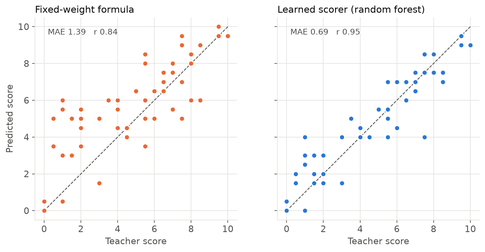

# AI Answer Evaluation System
     
A deep-learning-based evaluator for descriptive (theory) answers. It compares a
student's answer with a teacher's reference answer and marking rubric, then
returns marks, a concept checklist and written feedback. Answers can be typed or
uploaded as a photo of handwriting.

```
Student answer ──┐                       ┌─ Semantic similarity  (Sentence-BERT)
 (typed / photo  │   preprocessing       ├─ Concept coverage     (keywords + embeddings)
  → TrOCR)       ├──► + embeddings ──────┼─ Completeness         (reference-sentence coverage)
Reference answer │                       └─ Length, keyword-only share
+ rubric ────────┘                                │
                                                  ▼
                                    Scoring engine (learned regressor
                                    trained on teacher marks, or formula)
                                                  ▼
                                      Marks + concepts + feedback
```

## Quick start

```bash
python -m venv .venv && source .venv/bin/activate     # Windows: py -3.12 -m venv .venv, then .venv\Scripts\activate
pip install -r requirements.txt
python train.py          # trains the scorer, writes models/ and results/
python evaluate.py       # metrics + charts in results/
streamlit run app.py     # opens the web app
```

The first run downloads the Sentence-BERT model (`all-MiniLM-L6-v2`, about 90 MB).
For handwritten answers also run `pip install -r requirements-ocr.txt`; the TrOCR
model (about 1.3 GB) downloads the first time you upload an image.

## Project structure

| Path | What it does |
|---|---|
| `evaluator/text_utils.py` | Normalisation, sentence splitting, Porter stemming, phrase matching |
| `evaluator/embedder.py` | Sentence-BERT embeddings, with a TF-IDF fallback/baseline |
| `evaluator/core.py` | `AnswerEvaluator`: feature extraction, concept detection, scoring |
| `evaluator/scorer.py` | Rule-based formula and the learned scorer |
| `evaluator/feedback.py` | Rule-based feedback generation (incl. keyword-stuffing detection) |
| `evaluator/metrics.py` | MAE, RMSE, Pearson, Spearman, QWK, precision/recall/F1 |
| `evaluator/ocr.py` | Line segmentation + TrOCR handwriting recognition |
| `train.py` | Leave-one-question-out training of the scorer |
| `evaluate.py` | Metrics and charts for the report |
| `finetune_sbert.py` | Optional fine-tuning of Sentence-BERT on your marked answers |
| `app.py` | Streamlit web app (single answer, batch CSV, model performance) |
| `data/questions.json` | Question bank: reference answers + rubric concepts with weights |
| `data/student_answers.csv` | Teacher-marked answers with gold concept labels |

## How scoring works

1. **Semantic similarity**: the reference and student answers are encoded with
   Sentence-BERT; cosine similarity is rescaled to 0–1.
2. **Concept coverage**: each rubric concept is detected by a stemmed keyword match,
   or, with Sentence-BERT, by a student sentence whose embedding is close to the
   concept (cosine ≥ 0.55). Coverage is the weighted share of concepts found.
3. **Completeness**: how many reference sentences have a close match in the
   student answer, blended with relative length.
4. **Scoring engine**: a regressor (ridge, random forest or gradient boosting,
   chosen by cross-validation) trained on teacher marks maps these features to a
   score. Without a trained model, the formula
   `0.5·similarity + 0.3·coverage + 0.2·completeness` is used.

## Adding your own questions and data

* Add a question to `data/questions.json` with a reference answer and rubric
  concepts (`name`, `keywords`, `weight`).
* Add teacher-marked answers to `data/student_answers.csv`
  (`answer_id, question_id, student_answer, human_score, concepts_present`).
  `concepts_present` (semicolon-separated concept ids) is only needed for the
  concept-detection precision/recall metrics.
* Re-run `train.py` and `evaluate.py`.

**About the included dataset:** the 60 answers (6 questions × 10) are a seed
dataset written for this project to cover strong, partial, paraphrased,
keyword-only, incorrect and off-topic answers. Their scores and concept labels
were assigned by the project author, not by independent teachers. For the final
report, collect real answers and have a teacher mark them, then retrain.

## Fine-tuning Sentence-BERT (optional)

```bash
python finetune_sbert.py --epochs 4 --holdout-question Q6
python train.py --backend sbert --sbert-model models/sbert-finetuned
```

To use the fine-tuned model in the app, pass `sbert_model="models/sbert-finetuned"`
to `AnswerEvaluator` in `app.py`.

## Results

Leave-one-question-out cross-validation on 60 marked answers (the model is always
tested on a question it never saw during training), using Sentence-BERT
(`all-MiniLM-L6-v2`) and a random-forest scorer:

| Metric | Value |
|---|---|
| Mean absolute error | 0.69 marks (out of 10) |
| RMSE | 1.00 |
| Pearson / Spearman correlation | 0.95 / 0.94 |
| Quadratic weighted kappa | 0.94 |
| Answers within 1 mark of the reference mark | 80% |
| Concept detection precision / recall / F1 | 0.92 / 0.90 / 0.91 |

For comparison, the fixed 50/30/20 formula scored an average error of 1.39 marks,
and a lexical TF-IDF backend (`python train.py --backend tfidf`) scored 0.68.
On this small, keyword-friendly dataset the transformer matched the lexical
baseline on marking error and slightly improved concept recall.



## Running the app

```bash
streamlit run app.py
```

On Windows you can also double-click `run_app.bat`. Mark handwritten answers from
the command line with `python evaluate_handwriting.py photo.jpg Q1`.

## Presentation

`presentation/AI_Answer_Evaluator.pptx` is generated from the files in `results/`.
After re-running `train.py` and `evaluate.py` (for example with Sentence-BERT),
rebuild it so the numbers, charts and examples match:

```bash
cd presentation
npm install pptxgenjs react react-dom react-icons sharp
node build_deck.js
```

## Limitations

* Keyword matching does not understand negation ("does **not** need mutual exclusion").
* Lexical similarity is fooled by answers that reuse the right words with the
  wrong meaning (e.g. defining normalization as feature scaling).
* With small datasets the learned scorer can overfit; always report
  cross-validated results.
* Scores should support, not replace, a teacher's judgement.

## Tests

```bash
python -m pytest -q
```
